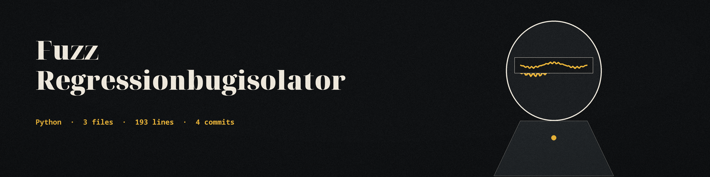

# fuzz-RegressionBugIsolator
Identifies the minimal input change required to trigger a regression bug, using a delta debugging approach. Takes two inputs: one that triggers the bug and one that doesn't. - Focused on Simplifies the process of generating and executing fuzzing payloads against web applications. Focuses on parameter manipulation and injection techniques to identify vulnerabilities such as SQL injection or XSS. Allows for quick iteration and vulnerability confirmation. An input counts as triggering when the response status is outside the success status codes; a target that cannot be reached is reported as a distinct result, never as not triggering. Exit codes: 0 when a change is isolated, 1 when no change is found (including when the stated triggering or non-triggering input does not test as stated and the target answered), and 2 when the target could not be reached or the payloads file could not be read.

## Install
`git clone https://github.com/ShadowStrikeHQ/fuzz-regressionbugisolator`

## Usage
`./fuzz-regressionbugisolator [params]`

## Parameters
- `-h`: Show help message and exit
- `--bug_triggering_input`: The input that triggers the regression bug.
- `--non_triggering_input`: The input that does not trigger the regression bug.
- `--url`: The URL to test against.
- `--parameter`: The parameter to fuzz.
- `--method`: No description provided
- `--payloads_file`: No description provided
- `--success_status_codes`: Comma-separated list of HTTP status codes considered as success. Defaults to 200.

## License
Copyright (c) ShadowStrikeHQ
